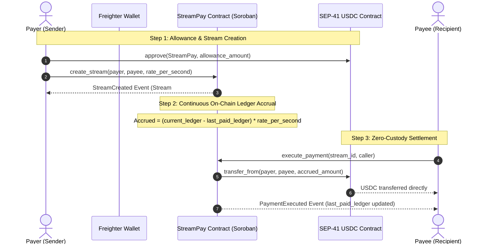
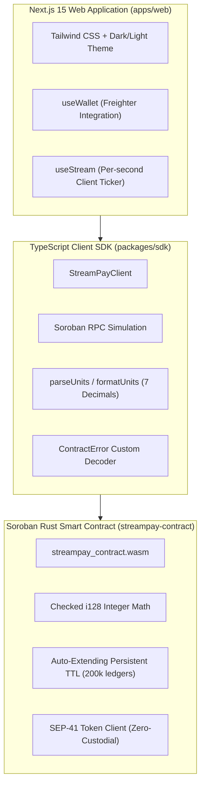
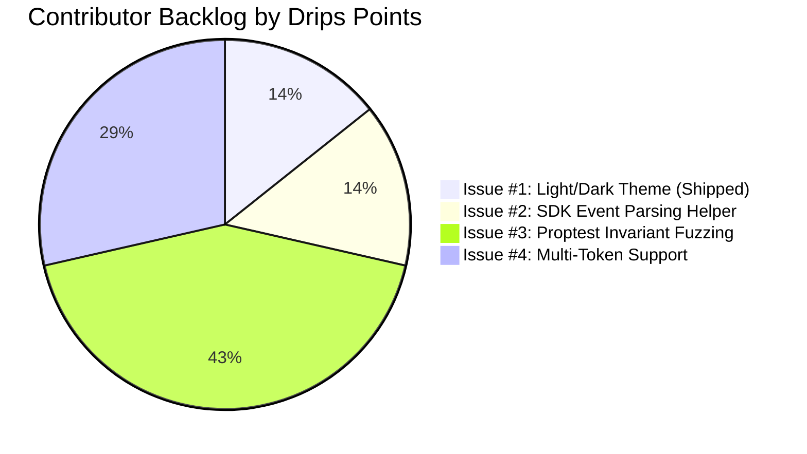

# 🌊 Drips Wave 11 Grant Submission Package: StreamPay

> **Applicant / Maintainer**: [@HassanKorey](https://github.com/HassanKorey)  
> **Project**: **StreamPay** — Continuous, Non-Custodial Streaming Payments on Stellar Soroban  
> **Application Category**: Open Source Maintainer & Web3 Infrastructure  
> **Target Wave**: Drips Wave 11  
> **License**: MIT  

---

## 1. Executive Summary & Pitch

### 💡 Elevator Pitch
**StreamPay** is a high-throughput, non-custodial streaming payment protocol and dApp natively built for **Stellar Soroban**. It empowers DAOs, protocols, and modern remote organizations to stream wages, subscriptions, grants, and consulting retainers continuously on a per-second basis using SEP-41 tokens (like USDC) with **zero locked principal** and **zero smart contract custodial risk**.

### 🧩 The Problem
Traditional recurring payments and Web3 token streams suffer from two major architectural flaws:
1. **Lump-Sum Capital Inefficiency**: Streaming solutions on other chains often demand that payers lock 100% of the stream's total future value upfront inside a smart contract vault for months at a time, trapping working capital.
2. **Custodial & Reentrancy Risk**: Vault-based streaming protocols introduce massive smart contract attack surfaces where hacker exploits can drain millions in pooled funds.

### ⚡ The Soroban Solution
StreamPay eliminates vault custody entirely. Leveraging **Stellar SEP-41 token allowances**, StreamPay calculates accrued compensation dynamically across consensus ledgers with integer-safe math. Funds remain liquid in the payer's Stellar wallet until the exact second of settlement, when anyone (payer, payee, or automated keeper) can trigger a permissionless settlement transfer.



---

## 2. Project Links & Production Deployments

| Component | Target / Environment | Verified Link / Identifier |
| :--- | :--- | :--- |
| **Live Web Application** | Vercel Edge Production | [stream-pay-orcin.vercel.app](https://stream-pay-orcin.vercel.app/) |
| **API Health Check** | Next.js 15 Health Probe | [stream-pay-orcin.vercel.app/api/health](https://stream-pay-orcin.vercel.app/api/health) |
| **GitHub Repository** | Public Monorepo | [github.com/HassanKorey/StreamPay](https://github.com/HassanKorey/StreamPay) |
| **Verified Contract** | Stellar Soroban Testnet | [`CCMKR6Z7WICENMZFAXR6VVWCM2TLHSKXOF5Q6ODJC4LHGMCJ5ZWKJECX`](https://stellar.expert/explorer/testnet/contract/CCMKR6Z7WICENMZFAXR6VVWCM2TLHSKXOF5Q6ODJC4LHGMCJ5ZWKJECX) |
| **SEP-41 USDC Token** | Stellar Soroban Testnet | [`CBGRKQQHFIVR6OXKTSOFONC53FFYMTZDAHJBHWQT6PC6EXQQFZ25Y5JC`](https://stellar.expert/explorer/testnet/contract/CBGRKQQHFIVR6OXKTSOFONC53FFYMTZDAHJBHWQT6PC6EXQQFZ25Y5JC) |
| **Continuous Integration**| GitHub Actions CI | [GitHub Actions Workflow (100% Green)](https://github.com/HassanKorey/StreamPay/actions) |

---

## 3. Verified On-Chain Consensus Cycle Proof

StreamPay is thoroughly verified through live consensus interactions on Stellar Soroban Testnet:

```
  [Stream #1 Created]           [Ledger Accrual]           [Settlement Executed]
Ledger: 5435330         ───►  ~5 Ledgers Elapsed  ───►  Ledger: 5435335
Rate: 1,000,000 stroops/s      Accrued: 5,000,000      Settled: 0.5000 USDC
```

1. **Stream Initialization**:
   - Stream ID `#1` was opened between payer and payee with a continuous flow rate of `1,000,000 stroops/sec` (0.10 USDC/sec).
   - Origin ledger recorded at `5435330`.
2. **Accrual Over Time**:
   - Over consecutive Stellar consensus rounds (~5 seconds per ledger), the smart contract accrued proportional value without requiring any transactions or gas during elapsed time.
3. **Permissionless Settlement Execution**:
   - `execute_payment(stream_id: 1, caller: G...)` was submitted to Soroban RPC.
   - The contract dynamically fetched the current consensus ledger (`5435335`), computed the accrued amount of `5,000,000 stroops` (0.5000 USDC), invoked `token_client.transfer_from`, transferred 0.50 USDC directly to the recipient's wallet, updated `last_paid_ledger`, and auto-extended its storage TTL by `200,000` ledgers.

---

## 4. Technical Architecture

StreamPay is built across three decoupled, high-performance layers:



### Key Technical Innovations
1. **Zero-Custodial Security Model**:
   - Unlike Ethereum ERC-1620 or traditional vault architectures where the contract holds user deposits, StreamPay never holds funds. Tokens flow peer-to-peer via SEP-41 allowances, removing the possibility of contract vault drainage.
2. **Overflow-Immune Checked Math**:
   - All rate and balance calculations use explicit Rust checked arithmetic (`checked_mul`, `checked_sub`, `checked_add`) returning domain-specific error codes (`ContractError::Overflow`).
3. **Storage TTL Self-Sustenance**:
   - Every mutation automatically extends contract instance storage and stream records by `200,000 ledgers` (~12 days of consensus), ensuring data persistence on Soroban state without manual fee bumps.
4. **Resilient Monorepo Architecture**:
   - Managed with `pnpm workspaces`, TypeScript 5, Node 22, Next.js 15 App Router, and automated GitHub Actions CI caching both Rust cargo artifacts and pnpm store dependencies.

---

## 5. Drips Wave-Ready Contributor Backlog

StreamPay strictly aligns with Ugonna Dike's [Creating Meaningful Issues](https://www.drips.network/blog/posts/creating-meaningful-issues) framework. Every issue includes explicit **Context & Motivation**, a **Scope & Implementation Blueprint**, **Acceptance Criteria**, copy-pasteable **Verification Commands**, and **Drips Wave Complexity Points**.



### Contributor Issue Portfolio

#### 🟢 Issue #1 (Shipped): Light/Dark Theme Toggle
- **Status**: ✅ **Closed & Deployed** (Commit `abe4ce1`)
- **Drips Complexity**: 1 Point (Good First Issue)
- **Impact**: Delivered full dark/light theme support, system preference detection (`prefers-color-scheme`), local storage persistence, and accessible high-contrast UI across all dashboard views.

#### 🟡 Issue #2 (Open): Implement Typed Event Parsing Helper in `@streampay/sdk`
- **Link**: [StreamPay Issue #2](https://github.com/HassanKorey/StreamPay/issues/2)
- **Status**: 🟢 **Open for Contributors**
- **Drips Complexity**: 1 Point (Good First Issue)
- **Scope**: Provide a typed `parseStreamEvents(txResponse)` utility that extracts `StreamCreated`, `PaymentExecuted`, `StreamPaused`, and `StreamCancelled` events from Soroban RPC transaction meta.
- **Verification**: `pnpm --filter @streampay/sdk test`

#### 🔵 Issue #3 (Open): Add Automated Invariant Fuzz Testing with `proptest`
- **Link**: [StreamPay Issue #3](https://github.com/HassanKorey/StreamPay/issues/3)
- **Status**: 🟢 **Open for Contributors**
- **Drips Complexity**: 3 Points (Core Smart Contract / Security)
- **Scope**: Implement stateful fuzz tests in `streampay-contract/tests/` asserting critical protocol invariants across random sequences of `create`, `pause`, `resume`, `update_rate`, and `execute_payment`:
  1. *Invariant 1*: Total transferred amount must never exceed `(current_ledger - start_ledger) * rate`.
  2. *Invariant 2*: Paused intervals never accrue value.
  3. *Invariant 3*: Zero tokens are transferred if `accrued == 0`.
- **Verification**: `cargo test --test fuzz_invariants`

#### 🟣 Issue #4 (Open): Multi-Token Selector Supporting Native XLM & Custom SEP-41 Tokens
- **Link**: [StreamPay Issue #4](https://github.com/HassanKorey/StreamPay/issues/4)
- **Status**: 🟢 **Open for Contributors**
- **Drips Complexity**: 2 Points (Frontend & SDK)
- **Scope**: Expand the creation form and dashboard to support arbitrary SEP-41 tokens (USDC, XLM wrapper, EURC) with dynamic token metadata fetching (symbol, decimals) via Soroban RPC.
- **Verification**: `pnpm --filter streampay-web build`

---

## 6. Drips Wave 11 Milestone Roadmap

| Milestone | Target Horizon | Deliverables | Allocation / Focus |
| :--- | :--- | :--- | :--- |
| **M1: Contributor Onboarding & Event Indexer** | Weeks 1–2 | • Merge SDK event helper (Issue #2)<br>• Review external PRs & mentor new contributors<br>• Publish automated changelog & SDK v0.2.0 | Contributor Mentorship & SDK |
| **M2: Contract Invariant Fuzzing & Security Audit** | Weeks 3–4 | • Merge `proptest` fuzzing suite (Issue #3)<br>• Formal verification of ledger arithmetic<br>• Automated gas benchmarking & optimization report | Security & Smart Contract Robustness |
| **M3: Multi-Token Engine & Mainnet Readiness** | Weeks 5–6 | • Merge Multi-token selector (Issue #4)<br>• Deploy SEP-41 XLM, USDC, EURC registry<br>• Release production Mainnet deployment guide | Mainnet Launch & Protocol Adoption |

---

## 7. Budget & Funding Allocation

Grant funds from Drips Wave 11 will be dedicated directly to open-source maintenance and ecosystem contributor bounties:

- **60% — Contributor Bounties & Drips Wave PR Rewards**: Distributed directly via Drips splits to community developers solving Wave issues (#2, #3, #4, and subsequent backlog items).
- **25% — Protocol Infrastructure & RPC Operations**: Dedicated Soroban RPC testnet/mainnet node infrastructure, persistent monitoring, and automated verification bots.
- **15% — Documentation & Developer Tooling**: Video walkthroughs, interactive tutorials for integrating `@streampay/sdk` into third-party Stellar dApps, and maintainer office hours.

---

## 8. Verification & Reviewer Instructions

Judges and reviewers can immediately inspect and test the protocol:

1. **Verify Contract On-Chain**:
   ```bash
   soroban contract inspect \
     --wasm target/wasm32v1-none/release/streampay_contract.wasm \
     --network testnet
   ```
2. **Execute Full Local Test Suite**:
   ```bash
   # 1. Smart contract tests (10 passing)
   cd streampay-contract && cargo test
   
   # 2. SDK test suite
   cd ../streampay-app && pnpm --filter @streampay/sdk test
   
   # 3. Next.js production build
   pnpm --filter streampay-web build
   ```
3. **Experience Live App**:
   Visit [https://stream-pay-orcin.vercel.app/](https://stream-pay-orcin.vercel.app/) with the Freighter wallet extension configured to **Testnet**.
